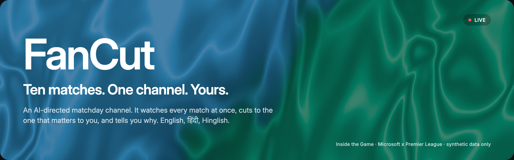
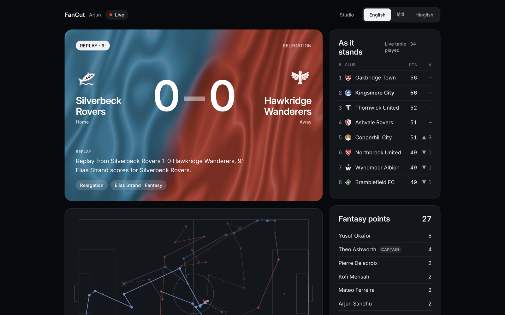
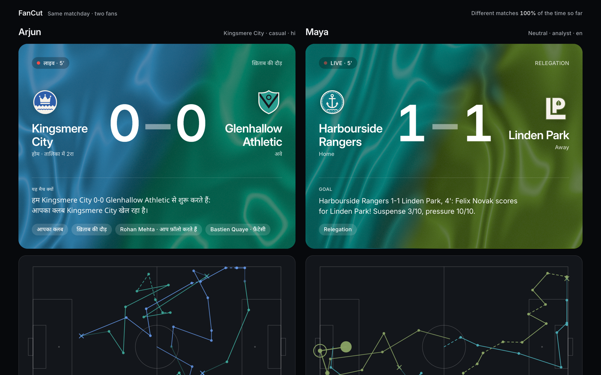
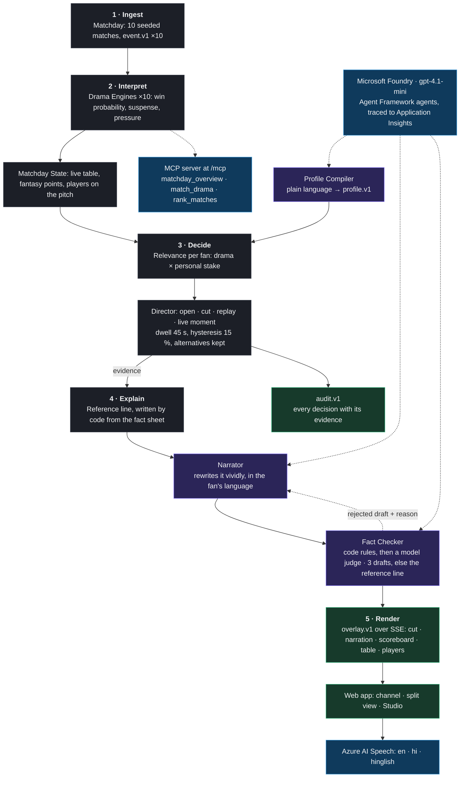

<p align="center">
  
</p>

<p align="center">
  <a href="https://github.com/eyekaushal/FanCut/actions/workflows/ci.yml"></a>
  
  
  
  
  <a href="LICENSE"></a>
  
</p>

**Your own AI-directed matchday channel. It watches every match at once, cuts to the one that matters to *you*, and tells you why.**

On a big matchday ten games kick off together. A fan cares about several of them: their club, the rivals in the table race, the players in their fantasy team. Whip-around shows exist for this (NFL RedZone, Goal Rush), but every one of them is a single human-produced feed, the same for everyone. FanCut is that show made for one person. Two fans watching the same matchday get two genuinely different channels, in English, हिंदी or Hinglish, and every cut comes with its evidence.



Built for **Inside the Game: Developer Hackathon** (Microsoft x Premier League), challenge *The Synthetic Match Insights Engine for Premier League Studio*. Everything is synthetic: twenty fictional clubs, fictional players, simulated matches. No real match data, footage, names or marks are used.

| | |
|---|---|
| **Demo video** | https://youtu.be/QhVRt6taUzo (under two minutes) |
| **Live demo** | https://ca-web-uqyqafwuy3rta.wittypond-5f858327.westus3.azurecontainerapps.io |
| **API** | https://ca-api-uqyqafwuy3rta.wittypond-5f858327.westus3.azurecontainerapps.io/health |
| **How to test it** | [docs/judges.md](docs/judges.md), five minutes, no login |
| **Architecture** | [docs/architecture.md](docs/architecture.md) and the [decision records](docs/adr/) |
| **Measurements** | [evals/README.md](evals/README.md) |

## What it does

The challenge asks for five stages. FanCut runs all five live, across a whole matchday, for each fan at once.

| Stage | What FanCut does |
|---|---|
| **Ingest** | Ten simultaneous `event.v1` streams from one seeded matchday (passes, carries, shots, goals, cards, with pitch coordinates), replayed at any speed |
| **Interpret** | A Drama Engine per match: win probabilities, **suspense** (how much the result is about to move) and **excitement** (how much it has moved), from published measures. A Matchday State keeps the live table and every fan's fantasy points |
| **Explain** | Every cut carries an evidence object: the chosen match's relevance, the alternatives it beat, the reasons, and a fact sheet. A reference line is written in code; the **Narrator** rewrites it vividly; the **Fact Checker** rejects anything the facts do not support |
| **Render** | A timed, machine-readable `overlay.v1` stream over server-sent events: cuts, narration, scoreboard, table, fantasy, pitch actions, per-player numbers. Our web app renders it; a broadcaster's graphics engine could render the same stream |
| **Personalize** | A profile in plain language ("Kingsmere fan, Mehta is my captain, Hinglish please") becomes a validated `profile.v1` and changes what is cut to, what is said, in which language and at what depth |

### The demo

- **The channel** (`/channel`): the match on air on a club-coloured silk card, the reason it is on air, the live table, fantasy points, a 2D pitch of the plays, and a player cam with numbers computed from the event stream. A replay interrupts for a moment the fan did not see live. Every goal in the match on screen gets its own line.
- **Two fans, side by side** (`/split`): Arjun (Kingsmere City, fantasy manager, Hindi) and Maya (neutral analyst, English) watch the same matchday. They are on different matches 60 to 91 percent of the time.
- **The Studio** (`/studio`): what a producer or an auditor sees. The decision log is the audit trail (`audit.v1`): every decision with its ranking, the reference line, the Narrator's line, and every draft the Fact Checker rejected and why. The overlay inspector shows the raw stream. The Trust strip shows the measurements below, computed by the API on the machine it runs on.
- **Voice**: every line read aloud by Azure AI Speech in the channel's language.
- **Recap**: the fan's matchday in a few sentences at full time, fact-checked like everything else.



## Microsoft stack

| Technology | Where it is used |
|---|---|
| **Microsoft Foundry** | The `gpt-4.1-mini` deployment behind the Narrator, the Fact Checker's judge and the Profile Compiler; the Azure AI Evaluation SDK scores the Narrator (groundedness, relevance, coherence, fluency); the same resource serves Azure AI Speech |
| **Microsoft Agent Framework** (Python) | Every model call is an Agent Framework agent named after its role, so every call is an OpenTelemetry span; Application Insights receives them in Azure |
| **MCP** | The Drama Engine is an MCP server at `/mcp` (`matchday_overview`, `match_drama`, `rank_matches`), so any agent or studio tool can ask how dramatic a match is or what a fan would be watching |
| **Azure AI Speech** | One neural voice per language; Hinglish is read in the Hindi voice |
| **Azure Container Apps** | Both services, provisioned by Bicep through the Azure Developer CLI, pulling images with a managed identity; hostnames wired automatically into CORS and the MCP allow-list |
| **Application Insights** | Traces, logs and metrics from the API |
| **GitHub Actions** | Lint, types, tests and build for the API and the web app; build and lint for the Bicep, on every pull request |

The Director, the Drama Engine, the fact sheets, the table and every number on screen are deterministic code. Without a model the channel runs end to end on its reference lines. The model makes it vivid; it never decides what is true.

## How it works



Grey boxes are deterministic code. Purple boxes are Agent Framework agents on a Foundry model. Blue is Azure. Green is what leaves the API.

**Relevance** is drama times personal stake. Drama blends suspense and pressure from the match's own probability path; stake adds the fan's club, a table rival within three places, followed players, fantasy players, the captain and the fixture's stakes. The Director re-ranks every ten seconds of play, never cuts away inside 45 seconds except for a must-show moment (a goal or red card involving the fan's club or players, which it replays and then cuts to), and only moves for a match at least 15 percent more relevant. Every decision keeps the alternatives it beat.

**Narration** starts from a correct line written by code from the fact sheet. The Narrator may only rewrite it. The Fact Checker runs cheap rules first (every number must be in the facts, every league name must be in the facts, Hindi must be Devanagari, a length cap) and then a model judge for what rules cannot see (the right names but the wrong team, a result declared before full time, invented history). Three drafts, then the reference line airs. A model outage never silences the channel.

More in [docs/architecture.md](docs/architecture.md).

## Measured

All of this is reproducible with `python -m fancut.evals` and shown live on the Studio's Trust strip. Details and methods in [evals/README.md](evals/README.md).

| What | Result | Target |
|---|---|---|
| Personal coverage: the fan's own goals and red cards seen live or replayed, 6 matchdays, 2 fans | 58/58 | 100% |
| Live coverage: decisive goals on air for a neutral fan | 19%, against 11% switching at random and 12% never switching | ≥ 1.4× random |
| Stability: routine cuts sooner than the 45 s dwell | 0 of 212 | 0 |
| Distinctness: share of a matchday two fans spend on different matches | 60% to 91% | ≥ 50% |
| Red team: 588 lines broken in eleven known ways, three languages | rules caught 372/372 of what rules can see, the judge 162/162 of the rest, 0 false rejects | |
| Grounding, manual review of 76 live model lines | 0 false claims, 1 true but unsupported addition | ≥ 98% |
| Foundry evaluators on 126 Narrator lines | groundedness 5.00, relevance 4.90, coherence 4.09 (100% pass), fluency 3.02 (94% pass) | |

The fluency score is the evaluator judging short broadcast lines by a prose rubric; the seven lines under its threshold are all Hinglish, which it reads as broken English. English and Hindi lines all passed.

## Responsible AI

- **The Director is code.** No language model chooses what you see. Every decision is deterministic and explainable from its evidence object.
- **Nothing reaches a fan unchecked.** Rules, then a judge, then the reference line. The audit trail records every rejected draft and its reason.
- **Every agent call is traced** through Agent Framework and Application Insights.
- **Synthetic data only.** Fictional clubs and players; profiles are demo profiles or what a visitor types.
- **Honest numbers.** The measurements above are computed by the shipped code; the Studio shows them with their method and date.

## Run it locally

Python 3.12 with [uv](https://docs.astral.sh/uv/), Node 22. No Azure account needed: without keys the Narrator speaks its reference lines and the voice switch hides itself.

```bash
# API, http://127.0.0.1:8000
cd api && uv sync && cp .env.example .env && uv run fancut

# Web, http://localhost:3000
cd web && npm ci && npm run dev
```

With a Foundry deployment and a Speech key in `api/.env` (see `api/.env.example`) the Narrator, the judge, the Profile Compiler and the voice switch on.

```bash
cd api && uv run pytest && uv run ruff check . && uv run mypy      # 134 tests
cd web && npm test && npm run lint && npm run typecheck && npm run build   # 80 tests
cd api && uv run python -m fancut.evals director                   # the Director numbers, ~30 s
cd api && uv run python -m fancut.director                         # two fans' channels, printed
```

Deploying to Azure is one `azd up`; see [infra/README.md](infra/README.md).

## Repository

| Path | What lives there |
|---|---|
| [`api/`](api/) | Python package `fancut`: `sim` (the league), `drama` (the engine), `director`, `agents` (Narrator, Fact Checker, Profile Compiler, recap), `insights` (player numbers), `api` (FastAPI, SSE, MCP, audit, evaluation routes), `evals` |
| [`web/`](web/) | Next.js 16 app: the channel, the split view, onboarding, the Studio, the design system and its gallery at `/design` |
| [`evals/`](evals/) | What is measured, how, and the recorded results |
| [`infra/`](infra/) | Bicep, `azure.yaml`, the deploy guide |
| [`docs/`](docs/) | Architecture, decision records, testing instructions for judges |

## Roadmap

Real broadcast video and multiview behind the same `overlay.v1` contract; real-data adapters for `event.v1`; push alerts through Azure Communication Services; more languages; native apps.

## License

[MIT](LICENSE)
